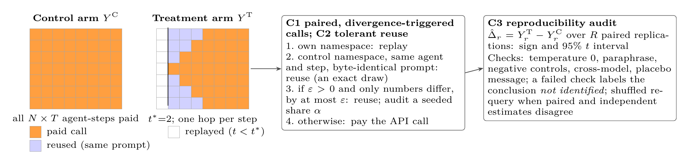
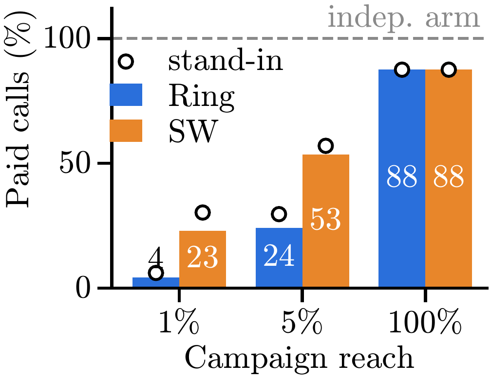
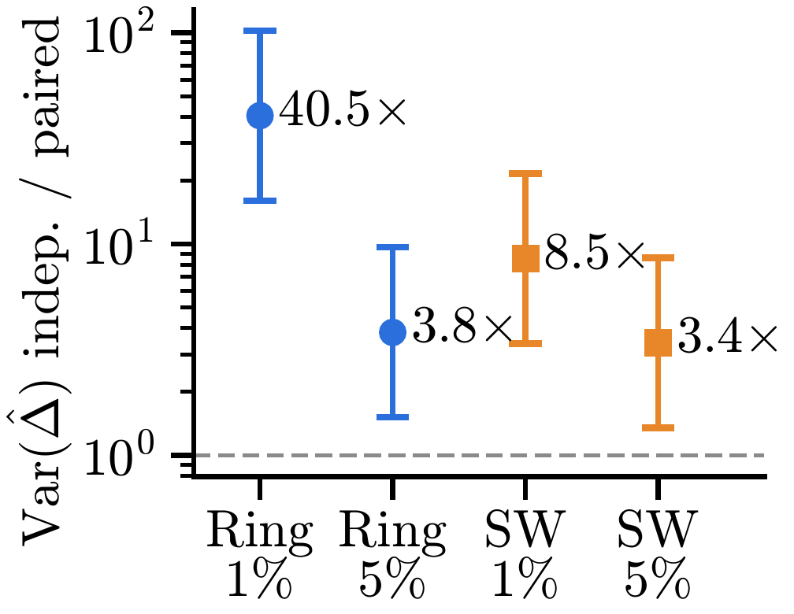

<div align="center">

# AdaCall: Spending an LLM Budget on Conclusions, Not Trajectories, in Counterfactual Social Simulation

[](https://socioverse.fudan-disc.com/challenge/) [](https://lassworkshop26.github.io/) [](LICENSE) [](https://www.python.org/)

Gangyi Zhang, Qinzhe Wang, Junyi Liu, Zhuolin Li, Liangfei Jin

Team Antarctic penguins
</div>

**1st Prize, Track C (Methodological and Systems Innovation), SocioVerse Challenge 2026.** AdaCall is a calling layer for counterfactual experiments in [SocioVerse2](https://github.com/sii-research/SocioVerse2): it spends the LLM budget on the estimated treatment effect rather than on recomputing unchanged trajectories, and it audits both approximate reuse and the conclusion itself.


## 🌟 Highlights
- **Pay only for divergence**: after an intervention, a treatment-arm agent whose prompt is byte-identical to its control-arm prompt reuses the control reply, an exact draw from the same distribution, so only diverged agents make new LLM calls and the effect estimate stays unbiased.
- **Fewer calls, lower variance**: on opinion diffusion (100 agents, ring and small-world networks, 20 paired replications with DeepSeek), the paired arm paid **4–54%** of the calls of an independent arm and reduced the variance of the estimated effect by **3.4× to 40×**.
- **Cost follows spillover**: **15%** of post-intervention calls were paid when prompts carry no spillover (car market, one German state targeted) and **45%** with group spillover (campus dining, 28% targeted).
- **Audits, including a negative result**: seeded audit calls flag a reuse tolerance that attenuates the effect by about 70%, but an admitted tolerance can still carry bias, so exact reuse stays the default. A placebo arm checks whether an effect comes from the message content or from being targeted.
- **Drop-in for SocioVerse2**: the studies use SocioVerse2's standard study format; AdaCall wraps only the LLM calling layer and leaves the platform code unchanged.

## 📰 News
- **[2026-11]** 🏆 **AdaCall** received the **1st Prize in Track C (Methodological and Systems Innovation)** of **SocioVerse Challenge 2026**, announced at the challenge session of [LASS 2026](https://lassworkshop26.github.io/), the 2nd Workshop on LLM Agents for Social Simulation, co-located with CIKM 2026 in Rome.


## 🔍 Overview of AdaCall

<div align="center">
  
  <p><em>Figure 1: Overview of AdaCall. A conventional branch pays for every agent-step; with paired, divergence-triggered calls (C1) only agents whose prompt has diverged from the control arm are paid. C2 adds optional tolerant reuse with seeded audits, and C3 audits whether the conclusion itself is reproducible.</em></p>
</div>


## 📊 Results

<div align="center">
  
  
  <p><em>Figure 2: (left) Paid calls as a share of an independent arm, by campaign reach; (right) variance reduction from pairing with exact 95% F intervals (opinion diffusion, DeepSeek, 20 replications per network).</em></p>
</div>

### Opinion diffusion (DeepSeek, 20 paired replications)

| Network | Reach | Paid (% of indep. arm) | Variance ratio [95% CI] | Equal-budget gain |
| :--- | :---: | :---: | :---: | :---: |
| Ring | 1% | 4.2% | 40.5× [16.0, 102.4] | 77.8× |
| Ring | 5% | 24.1% | 3.8× [1.5, 9.6] | 6.2× |
| Small-world | 1% | 23.0% | 8.5× [3.4, 21.6] | 13.9× |
| Small-world | 5% | 53.5% | 3.4× [1.4, 8.6] | 4.4× |
| Ring / Small-world | 100% | 87.5% | – | – |

### Spillover structure (DeepSeek)

| Testbed, target | Spillover | Replications | Paid (% of post-intervention calls) |
| :--- | :---: | :---: | :---: |
| Car market, Bavaria | none | 5 | 15.0% |
| Campus dining, 5 dorms | group | 20 | 44.5% |
| Opinion diffusion, 1–5% reach | network | 20 | 4.8–61.1% |

> *A global intervention (100% reach) changes every prompt, so pairing saves little; savings are largest for local interventions and sparse networks.*


## ⚙️ Installation

Requires Python 3.11 and git.

```bash
git clone https://github.com/zhanggangyi1224/AdaCall.git
cd AdaCall
bash scripts/setup.sh            # clones SocioVerse2 at the pinned commit 9c3ac77, links the studies, installs it
python -m pytest adacall/tests -q
```

## 🚀 Usage

```bash
python run.py                                                         # free stand-in LLM, no API key
python run.py --mode live --study od --model deepseek-flash --reps 5  # real LLM
```

- **Stand-in mode** runs every design on all three testbeds with fixed seeds and writes about 1.2 GB to `adacall/runs/`.
- **Live mode** reads the provider key from `SocioVerse2/.env` (`SV_LLM_API_KEY`, or the provider-specific variables listed in `studies/adacall_od/model.py`). `--study` is `od`, `germany` or `campus`.
- Every reply is cached in `<out>/cache.jsonl`, so an interrupted run resumes without paying twice and a rerun with the same cache makes no API calls. Each runner writes `summary.json` and `runs.csv` to its `--out` directory; `python adacall/<runner> --help` lists the options.

## 📁 Repository Structure

| Path | Contents |
| :--- | :--- |
| `adacall/cache.py` | Paired response cache: exact replay, paired reuse, optional numeric tolerance with audit sampling |
| `adacall/run_od.py` | Control, paired and independent arms on the opinion-diffusion study |
| `adacall/run_paired.py` | The same design on the car-market (`germany`) and campus-dining (`campus`) studies |
| `adacall/run_eps.py` | Tolerance sweep with audit calls (C2) |
| `adacall/run_audit.py` | Conclusion audit: placebo, temperature 0, paraphrase, prompt decomposition (C3) |
| `studies/adacall_{od,germany,campus}/` | SocioVerse2 studies: population, environment, simulation and behaviour model |


## 📑 Citation

If you find AdaCall useful in your research, please cite our work:

```bibtex
@misc{zhang2026adacall,
  title={AdaCall: Spending an LLM Budget on Conclusions, Not Trajectories, in Counterfactual Social Simulation},
  author={Zhang, Gangyi and Wang, Qinzhe and Liu, Junyi and Li, Zhuolin and Jin, Liangfei},
  howpublished={SocioVerse Challenge 2026, Track C (1st Prize). Presented at LASS 2026, the 2nd Workshop on LLM Agents for Social Simulation, co-located with CIKM 2026},
  year={2026},
  url={https://github.com/zhanggangyi1224/AdaCall}
}
```

## 🙏 Acknowledgments

We thank the [SocioVerse](https://github.com/sii-research/SocioVerse2) team for the simulation platform and the SocioVerse Challenge 2026 organizers for their support.

---

## 📬 Contact
For questions, please contact `zhanggangyi1224@gmail.com`.
